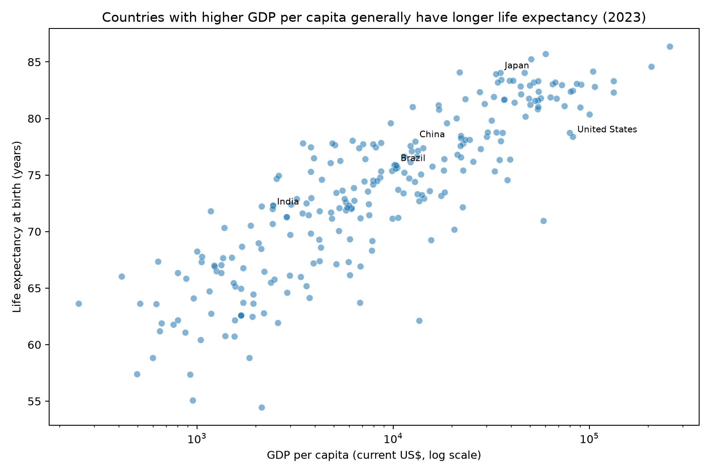
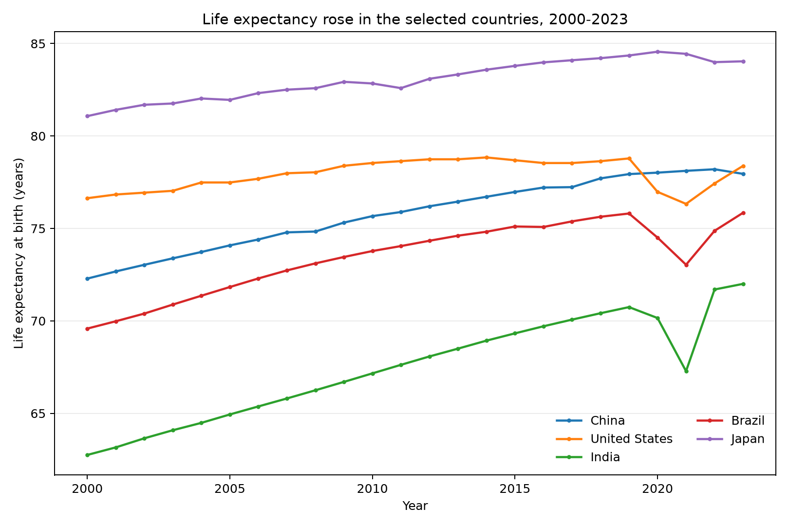

# LI HONGXI | Data Science Portfolio

I am a student developing practical skills in data analysis, reproducible research and data storytelling. This portfolio presents a small public-data project and the evidence behind its conclusions.

## Technical skills

- Python: pandas, requests and matplotlib
- Jupyter-style reproducible analysis and GitHub documentation
- Data cleaning, exploratory analysis and visual communication

## Featured project: Life Expectancy and GDP per Capita

**Research question:** Across countries, how are GDP per capita and life expectancy related, and how has life expectancy changed in selected countries since 2000?

The project uses public World Bank indicators. Its analysis finds a generally positive cross-country association between income per person and life expectancy. This does not prove causation: health systems, education, inequality, conflict and environmental conditions may also affect life expectancy.

### Visualisation

The project repository contains a scatter plot of GDP per capita and life expectancy in the latest available year, plus a trend chart for China, the United States, India, Brazil and Japan.

*Figure 1. Countries with higher GDP per capita generally have longer life expectancy in 2023. The relationship is descriptive rather than causal.*

*Figure 2. Life expectancy increased across the selected countries between 2000 and 2023, but the level and pace of improvement varied.*

### Key limitation

This portfolio shows an association between GDP per capita and life expectancy, not a causal effect. The analysis is also limited because country-level averages can hide important differences within countries.

### Project link and status

- [Open the project repository](https://github.com/Lhei512/data-science-project)
- **Status:** Completed

## Responsible use

The source data are public World Bank indicators. No personal, restricted or confidential data are included in this portfolio.
